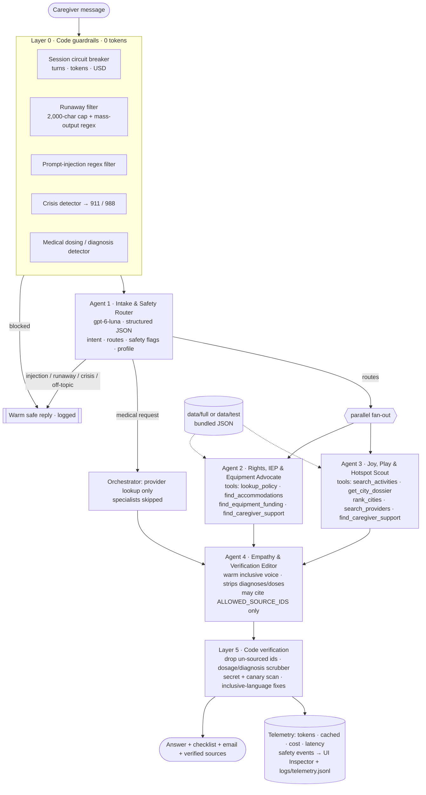

# Joy Risers: Multi-Agent Architecture

## Mermaid diagram



## ASCII version

```
caregiver message
      │
      ▼
┌──────────────────────── Layer 0 · code guardrails (no tokens) ────────────────────────┐
│ session circuit breaker │ runaway filter │ injection regex │ crisis │ medical detector │
└───────────────────────────────────────────────────────────────────────────────────────┘
      │ pass                                         │ block → warm safe reply ($0.00)
      ▼
┌─────────────────────────────────────┐
│ Agent 1 · Intake & Safety Router    │  JSON: intent, routes[], safety{}, profile{}
└─────────────────────────────────────┘
      │ routes                 │ medical → provider lookup only     │ attack → blocked
      ├──────────────┬─────────┘
      ▼              ▼            (run in parallel threads)
┌──────────────┐ ┌───────────────┐
│ Agent 2      │ │ Agent 3       │   each: ≤4 tool rounds over local JSON tools,
│ Advocate     │ │ Scout         │   structured JSON draft with source_ids
└──────────────┘ └───────────────┘
      └──────┬───────┘
             ▼
┌─────────────────────────────────────┐
│ Agent 4 · Empathy & Verification    │  JSON: headline, message, email, checklist,
│ Editor                              │  sources (ALLOWED_SOURCE_IDS only), removals
└─────────────────────────────────────┘
             ▼
┌─────────────────────────────────────┐
│ Layer 5 · code verification         │  drop invented sources · scrub doses/diagnoses
│                                     │  redact keys/canary · fix exclusionary words
└─────────────────────────────────────┘
             ▼
 answer → UI      telemetry → Inspector drawer + logs/telemetry.jsonl
```

## Why this design

| Choice | Why |
|---|---|
| Code guardrails before and after the model | Regex filters, budgets and scrubbers can't be argued with. Obvious attacks cost **$0.00** because no model is called. |
| Router agent with structured safety flags | Catches subtle attacks the regex misses (see the "stealth" red-team test) and routes only to the specialists a question needs. |
| Two specialists in parallel | IEP/equipment questions and play/place questions need different tools; running both at once cuts wall-clock time. |
| Tools over bundled JSON | Agents can only cite records that exist. Each record has a `source_id`, so the editor and code can verify grounding. |
| Editor agent last | Inclusive voice standards, clinical boundary and hallucination check happen on every answer, not as an afterthought. |
| One model (gpt-6-luna) | Course rule; it is fast and cheap. Reasoning effort is set to low and outputs are strict JSON schemas. |

## Prompt caching

Every agent's instructions = **SHARED_PREFIX** (≈1,300 tokens: brand voice, inclusion standards, safety
policy, data dictionary) + a static role block. All dynamic text (the caregiver's message, drafts, ids)
goes in the user turn *after* the instructions. Each agent uses its own `prompt_cache_key`
(`joy-risers-intake`, `…-advocate`, `…-scout`, `…-editor`), so repeat calls read the prefix from cache at
$0.01/1M instead of $0.10/1M. The Inspector shows cached tokens and the % saved vs. no caching.

## Budget limits (`backend/config.py → LIMITS`)

| Limit | Value |
|---|---|
| Message length | 2,000 characters |
| Joy Compass turns per session | 25 |
| Tokens per session (all agents) | 150,000 |
| Dollar ceiling per session | $0.25 |
| Model calls per run | 10 |
| Tool rounds per specialist | 4 (last round forced to answer) |
| Output tokens per call | 8,000 |
